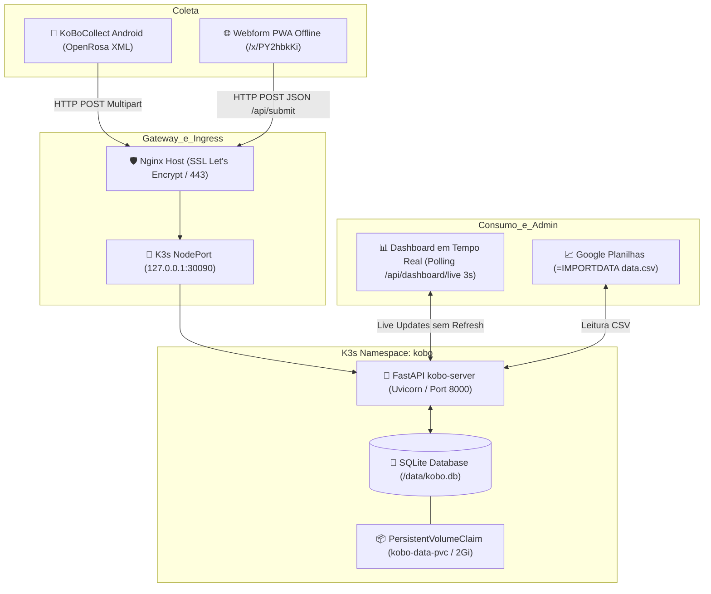

# 🌐 KoBoToolbox Native Server — Igreja Renova-me

Servidor nativo compatível com o ecossistema **KoBoToolbox / OpenRosa (ODK)**, desenvolvido em Python / FastAPI e otimizado para execução de altíssima eficiência e baixo consumo de recursos no cluster **Kubernetes K3s** (arquitetura ARM64 / Ampere A1 e x86_64).

Substitui a infraestrutura pesada original do KoBoToolbox (PostgreSQL, Redis, Celery, Django/KPI, Enketo Express e Kobocat, que exigiam > 4GB RAM) por um único binário/contêiner leve (~40MB RAM e ~20m CPU), mantendo **100% de retrocompatibilidade** com o aplicativo móvel **KoBoCollect**, formulários web Enketo, exportações para **Google Sheets** e painel administrativo em tempo real.

---

## 📌 Links Rápidos & Endpoints de Produção

| Serviço / Recurso | URL em Produção | Acesso / Autenticação |
|---|---|---|
| 📋 **Formulário Web dos Missionários** | [https://kobo.gabrielcjr.website/x/PY2hbkKi](https://kobo.gabrielcjr.website/x/PY2hbkKi) | Aberto aos missionários (PWA offline, sem links administrativos) |
| 📊 **Painel Administrativo (Live)** | [https://kobo.gabrielcjr.website/dashboard](https://kobo.gabrielcjr.website/dashboard) | HTTP Basic Auth (`renovamechurch`) |
| 📈 **Exportação de Dados (CSV / TSV)** | `https://kobo.gabrielcjr.website/campo-missionarios.csv` | HTTP Basic Auth (Protegido por segurança dos dados) |
| 📥 **Exportação Excel (.xlsx)** | `https://kobo.gabrielcjr.website/api/export/xlsx` | HTTP Basic Auth |
| 🗺 **Exportação GeoJSON** | `https://kobo.gabrielcjr.website/api/export/geojson` | HTTP Basic Auth |
| 📲 **OpenRosa Form Discovery** | `https://kobo.gabrielcjr.website/formList` | HTTP Basic Auth |
| 🩺 **Healthcheck / Probe K8s** | `https://kobo.gabrielcjr.website/healthz` | Aberto (retorna HTTP 200 `status: ok`) |

---

## 🔐 Credenciais de Acesso

* **Usuário:** `renovamechurch`
* **Senha:** `Rvehonraegloria`
* **Escopo:** Aplicativo móvel KoBoCollect, Painel de Controle (`/dashboard` e `/admin`), endpoint de polling em tempo real (`/api/dashboard/live`) e exportações analíticas.

---

## 🏛 Arquitetura do Sistema



---

## 📂 Estrutura do Repositório

```text
/home/ubuntu/k8s_kobo/
├── app/
│   ├── forms/
│   │   ├── Missionarios_Renovame.xml   # Definição XForm XML padrão OpenRosa
│   │   └── form_metadata.json          # Metadados e schema da API v2 do Kobo
│   ├── static/                         # Banner, PWA manifest e Service Worker
│   ├── templates/
│   │   ├── webform.html                # Formulário responsivo PWA (estilo Enketo) com fila offline
│   │   └── dashboard.html              # Painel analítico com auto-refresh em tempo real e mapa Leaflet
│   ├── database.py                     # Camada SQLite, persistência, parser GPS e estatísticas
│   ├── main.py                         # Rotas FastAPI (OpenRosa, Web, API v2, Live Dashboard, CSV)
│   └── openrosa.py                     # Parser de submissões XML multipart do KoBoCollect
├── k8s/
│   ├── 00-namespace.yaml               # Namespace Kubernetes `kobo`
│   ├── 01-pvc.yaml                     # PVC `kobo-data-pvc` (local-path, 2Gi)
│   ├── 02-deployment.yaml              # Deployment com probes, volume e recursos
│   └── 03-service.yaml                 # NodePort 30090 redirecionado pelo Nginx
├── tests/
│   ├── conftest.py                     # Fixtures do pytest (TestClient, DB em memória)
│   ├── test_openrosa_protocol.py       # Testes do protocolo KoBoCollect
│   ├── test_kobo_api_google_sheets.py  # Testes de integração CSV / Google Sheets
│   ├── test_webform_offline_pwa.py     # Testes da PWA, segurança e remoção de dashboard
│   ├── test_dashboard_auth.py          # Testes de Basic Auth e live polling
│   └── test_database_persistence.py    # Testes do banco SQLite e geopoints
├── Dockerfile                          # Build da imagem Docker leve (python:3.12-slim)
├── requirements.txt                    # Dependências de produção
├── requirements-dev.txt                # Dependências de testes (pytest, httpx)
├── README.md                           # Este documento
└── MAINTAINER_GUIDE.md                 # Manual operacional para futuros mantenedores
```

---

## 🧩 Principais Componentes e Regras de Negócio

### 1. Protocolo OpenRosa (KoBoCollect / ODK Collect)
* O app Android se conecta informando a URL do servidor (`https://kobo.gabrielcjr.website`), usuário e senha.
* **Descoberta:** `GET /formList` retorna o catálogo XML com hash MD5 do formulário `a7FqboN3tiXKPo6hSc8MzJ`.
* **Download:** `GET /formXml` entrega o formulário compilado XForm.
* **Submissão:** `HEAD /submission` valida as credenciais com resposta HTTP 204/OpenRosa, e `POST /submission` recebe o payload multipart/form-data com o XML preenchido no celular.

### 2. Formulário Web PWA Offline (`/x/PY2hbkKi`)
* **Interface:** Visual moderno inspirado no Enketo KoBoToolbox com banner oficial da Igreja Renova-me.
* **Suporte Offline:** Possui Service Worker (`/sw.js` e `/x/offline-app-worker.js`) e Web App Manifest (`/manifest.json`), permitindo instalação como aplicativo na tela inicial do celular.
* **Fila Local:** Permite salvar rascunhos e armazena fichas em fila local (`localStorage`) quando o missionário está em áreas remotas sem sinal de internet.
* **Sincronização Automática:** Assim que o dispositivo detecta sinal de internet (`window.addEventListener('online')`), os registros da fila são transmitidos ao servidor em segundo plano.
* **🔒 Política Estrita de Segurança da Informação:**
  * **Sem acesso ao painel:** Nenhum link, botão ou referência ao `/dashboard` ou `/admin` existe no formulário. O usuário comum não pode acessar dados de outros missionários.
  * **Sem exportação local:** Foi removido o botão de exportar backup em JSON para evitar vazamento de dados locais.
  * **Purga Imediata pós-envio:** Assim que uma ficha é enviada com sucesso ao servidor (seja envio direto ou sincronização em lote), ela é **removida permanentemente da memória do aparelho**. Apenas rascunhos incompletos e fichas pendentes de envio são mantidos no dispositivo.

### 3. Painel Administrativo em Tempo Real (`/dashboard`)
* Protegido por Basic Auth (`renovamechurch:Rvehonraegloria`).
* **Auto-Atualização sem Refresh de Tela:** Executa polling assíncrono a cada 3 segundos via [`/api/dashboard/live`](file:///home/ubuntu/k8s_kobo/app/main.py#L286-L308):
  * Novos registros são injetados no topo da tabela com destaque animado (*glow verde*).
  * Os cards de KPI (*Total de Vidas*, *Hoje*, *Receberam Jesus*, *Missionários Ativos*) são incrementados automaticamente.
  * O mapa interativo (Leaflet) plota instantaneamente novos marcadores geográficos com popups informativos.
  * Mantém filtros de busca ativos sem interrupção para o administrador.

### 4. Integração Segura com Google Planilhas (Copiar e Colar)
* **Remoção da API Aberta por Segurança:** Por segurança da informação dos contatos de campo, o acesso anônimo à API de exportação foi desativado (retornando HTTP 401).
* **Novo Fluxo de Transferência (Copiar e Colar):** Ao invés de usar `=IMPORTDATA()`, a liderança copia os registros diretamente no Dashboard (em formato TSV de 16 colunas A..P) e cola na célula `A{linha}` do Google Sheets.
* **Fórmulas Automáticas Geradas:**
  * **WhatsApp (Coluna G):**
    ```excel
    =IF(ISBLANK(F510); ""; IF(F510 = 0; "Telefone não informado"; HYPERLINK("https://wa.me/55" & F510; "Chamar no WhatsApp")))
    ```
  * **Mapa (Coluna O):**
    ```excel
    =IF(ISBLANK(N510); ""; IF(N510 = "[NULL,NULL]"; "Localização não capturada";IF(N510 = "[0.1,0.1]"; "Localização não capturada"; IF(N510 = "[1,1]"; "Localização não capturada"; IF(N510 = "[1,2]"; "Localização não capturada";HYPERLINK("https://www.google.com/maps?q=" & REGEXEXTRACT(N510; "-?\d+\.\d+,-?\d+\.\d+"); "Ver no mapa"))))))
    ```
* **Botão Individual "Copiar Linha":** Cada ficha na tabela possui botão para cópia individual imediata, auto-incrementando o número da próxima linha na planilha.

---

## 🛠 Guia Operacional Rápido

### Executar a Suíte de Testes (42 Testes)
```bash
source /home/ubuntu/k8s_kobo/.venv/bin/activate
pytest /home/ubuntu/k8s_kobo/tests -v
```

### Construir e Publicar Nova Versão no Kubernetes K3s
```bash
# 1. Gerar a imagem docker
docker build -t kobo-server:latest /home/ubuntu/k8s_kobo

# 2. Importar para o containerd do K3s
docker save kobo-server:latest | sudo k3s ctr images import -

# 3. Reiniciar a aplicação no K3s
kubectl rollout restart -n kobo deploy/kobo-server

# 4. Acompanhar a subida do pod
kubectl rollout status -n kobo deploy/kobo-server
```

### Verificar Logs em Tempo Real
```bash
kubectl logs -n kobo deploy/kobo-server -f
```

### Backup do Banco de Dados SQLite
O banco de dados fica armazenado persistentemente no volume `/data/kobo.db` dentro do contêiner:
```bash
# Copiar o banco diretamente do pod para a máquina host
POD_NAME=$(kubectl get pods -n kobo -l app=kobo-server -o jsonpath="{.items[0].metadata.name}")
kubectl cp kobo/${POD_NAME}:/data/kobo.db /home/ubuntu/backup_kobo_$(date +%Y%m%d_%H%M%S).db
```

---

Para procedimentos aprofundados, renovação de certificados SSL, restauração de desastres e detalhamento de variáveis de ambiente, consulte o [MAINTAINER_GUIDE.md](file:///home/ubuntu/k8s_kobo/MAINTAINER_GUIDE.md).
